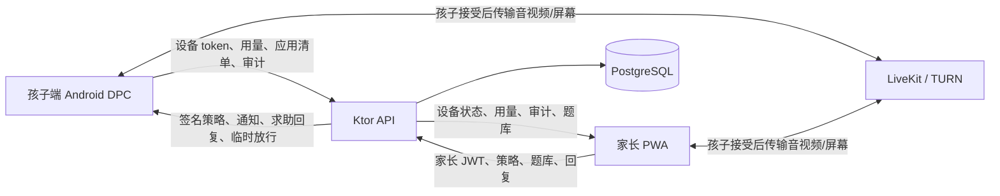

# Guard 隐私数据流与留存说明

更新日期：2026-11-13

本文档描述代码当前实际处理的数据，不替代正式隐私政策、数据处理协议或所在司法辖区的合规评估。自托管部署的运营者仍需确定数据控制者、处理者、跨境传输、未成年人同意和保留期限。

## 1. 数据角色

- 孩子端：在受管 Android 设备本地执行策略，保存本地策略、额度、队列和审计；受 Device Owner 管理。
- 家长 PWA：家长在浏览器中输入账户、策略和题库内容，并通过 JWT 访问 API。
- Ktor 服务端：认证、设备所有权、签名策略、用量、审计、求助、通知和题库托管。
- PostgreSQL：保存账户、设备和业务元数据；不保存媒体流。
- LiveKit：仅在孩子端接受通话/屏幕共享请求后传输实时媒体；服务端不把媒体流写入数据库。

## 2. 数据流

## 3. 本地数据

| 数据 | 位置 | 用途 | 当前保护 |
| --- | --- | --- | --- |
| 已验证签名策略、revision、公钥 | 孩子端 `SharedPreferences` | 离线执行和防回滚 | 由签名验证保护，静态文件未另行加密 |
| 设备 token | 孩子端本地存储 | 访问服务端 | AES-GCM，密钥位于 Android Keystore |
| 额度/用量、冷却、触发状态 | 孩子端 `SharedPreferences` | 本地执行与去重 | 普通应用私有存储 |
| 答题结果离线 outbox | 孩子端 `SharedPreferences` | 断网补传 | 普通应用私有存储，不含标准答案 |
| 求助 outbox 和回复缓存 | 孩子端 `SharedPreferences` | 离线排队和显示家长回复 | 普通应用私有存储，**尚未静态加密** |
| 通知、临时放行、grant id 与提醒去重状态 | 孩子端 `SharedPreferences` | 展示、执行和撤销匹配 | 普通应用私有存储 |
| 截图授权会话 | Android `MediaProjection` 运行时 | 单帧截图 | 运行时授权，不持续录屏 |

本地 `SharedPreferences` 依赖 Android 应用沙箱和锁屏保护。若威胁模型要求抵御已 root 设备、取证镜像或系统级恶意软件，必须升级为受保护存储并重新评审；当前实现不能承诺该强度。

## 4. 服务端数据

| 数据 | 主要字段 | 用途 | 当前留存 |
| --- | --- | --- | --- |
| 家长账户 | 邮箱、PBKDF2 密码哈希 | 登录和所有权 | 直到账户删除 |
| 家长会话 | 会话 ID、创建/过期/撤销/最后访问时间 | 登录撤销和令牌校验 | 有效期内保留；过期或撤销 30 天后由后台任务清理 |
| 设备 | 设备 ID、公钥、名称、平台、配对/吊销状态、最后在线 | 身份和配对 | 直到设备或账户删除 |
| 策略历史 | 签名 envelope、revision、payload | 下发和防回滚 | 直到设备或账户删除；无自动时限 |
| 用量 | 日期、应用分钟数、健康摘要 | 家长查看和额度 | 直到设备或账户删除；无自动时限 |
| 审计 | 行为者、事件、详情、时间 | 可追溯性 | 直到设备或账户删除；无自动时限 |
| 应用清单 | 包名、标签、分类、启用状态 | 家长编辑 | 直到设备或账户删除 |
| 临时放行/通知/通话请求 | 状态、时间、目标包、applied/撤销状态和操作者 | 执行、可见同意和撤销 | 直到设备或账户删除 |
| 题库与密钥转移 | 签名包、公钥、版本、转移原文 | 答题闸门 | 直到账户删除 |
| 求助 | 原因、留言、家长回复、状态 | 家长协助 | 直到设备或账户删除 |
| 答题结果 | 汇总、题目标识和作答正误、元数据 | 家长查看 | 直到设备或账户删除；不保存标准答案 |
| 截图 | 单帧 JPEG、尺寸、创建/过期时间 | 家长显式请求的单次截图 | 15 分钟后不可读取，后台任务每分钟清理一次过期行；家长结束请求后孩子端停止捕获 |

服务端不保存孩子聊天内容、键盘输入、实时音视频、持续录屏、设备通讯录或短信。审计详情也不应写入 PIN、token、私钥或截图正文。

## 5. 删除与留存

- 家长可在 PWA 的 Account 页面提交删除，调用 `POST /api/v1/me/delete`。
- 服务端要求有效家长 token、精确账户邮箱、当前密码和精确确认词 `DELETE`，并在单个事务中删除家长、设备、家长会话及关联业务数据。
- 删除后家长 token、设备 token、重新登录和 `/api/v1/me` 均失效；另一家长的数据不受影响。
- 自动化 JVM 测试和本地 Docker PostgreSQL 端到端已覆盖跨表删除、账户隔离和 token 失效；真实生产环境及备份删除传播演练仍为**未执行**。
- 数据库备份、WAL/PITR、对象存储快照和外部日志不在删除事务内。运营者必须配置备份保留期和删除请求传播流程，否则备份中仍可能短期保留已删除数据。
- 本地孩子设备上的缓存策略和本地队列不会因为服务端账户删除而自动抹除；设备应在重新配对、恢复出厂或受管擦除流程中处理。发布说明必须明确这一边界。

## 6. 日志与诊断

- 服务端请求日志记录方法、路径、状态码和耗时，可能包含设备/资源 ID；不记录请求正文、密码、JWT 或私钥。
- 反向代理和平台层可能记录客户端 IP、User-Agent 和时间。运营者应设置访问日志保留期和访问控制。
- 应用错误日志不得写入密码、token、私钥或求助留言正文；新增日志必须遵守该约束。

## 7. 发布前隐私证据

- [ ] 完成正式隐私政策和儿童/监护人告知文本。
- [ ] 明确控制者、处理者、数据位置、跨境安排和联系渠道。
- [ ] 在生产环境完成账户删除演练并验证备份过期。
- [ ] 明确设备退回、解绑、恢复出厂和丢失设备的本地数据清除流程。
- [ ] 评审求助队列静态加密需求并记录接受或整改结论。
- [ ] 完成访问日志、备份和监控数据的保留期配置。
