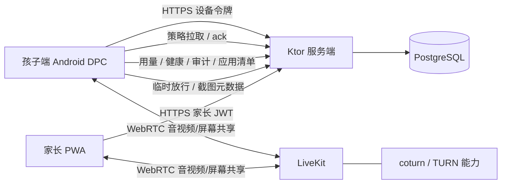

# Guard 技术方案

## 1. 方案结论

Guard 采用“Android 原生 Device Owner 孩子端 + 本地优先策略引擎 + 自托管 Ktor 服务 + React PWA 家长端 + LiveKit 媒体”的架构。设备策略不依赖云端在线；云端只负责家长授权、签名策略分发、用量/审计汇总和显式同意的媒体协助。

核心原则：

1. 不通过 root、漏洞、无障碍服务或隐藏进程实现控制。
2. 设备只在受支持的企业管理边界内执行策略；离线时继续执行最后一次已验证策略。
3. 策略和服务端身份绑定到签名密钥与 revision，失败时拒绝更新而不是放宽限制。
4. 摄像头、麦克风、屏幕共享和截图都必须有孩子端可见授权与审计记录。
5. 不以“绝对不可卸载/绝对不可杀”为承诺，保留恢复和解除管理路径。

## 2. 总体架构



服务端不保存孩子端媒体流。截图是用户明确同意的单帧 JPEG，服务端只保留 15 分钟；LiveKit token 只在通话请求被孩子端接受后签发。

## 3. 代码组织

```text
guard-product/
├─ android/app/src/main/java/com/example/lockdowndpc/
│  ├─ admin/       DeviceAdminReceiver、管理能力
│  ├─ guard/       GuardPolicy、策略执行、同步、题库、通话、截图
│  ├─ kiosk/       受管 kiosk HOME、导航护栏、配置状态机
│  ├─ maintenance/ 维护模式
│  ├─ policy/      系统策略适配、策略协调和审计
│  ├─ recovery/    紧急访问窗口、到期广播和 Device Owner 解除
│  ├─ security/    PIN、标签清洗等安全辅助
│  └─ ui/          Compose 管理界面
├─ server/src/main/kotlin/com/guard/server/
│  ├─ Application.kt      依赖装配、路由和错误处理
│  ├─ Config.kt           环境变量与 *_FILE secret
│  ├─ Crypto.kt           策略签名、设备证明、限流/重放保护
│  ├─ Models.kt           请求/响应 DTO
│  ├─ Repository*.kt      JDBC 数据访问
│  ├─ PolicyValidator.kt  策略字段白名单和规范化
│  ├─ QuizPacks.kt        签名题库验签、托管与版本管理
│  ├─ QuizUpstream.kt     可信上游地址策略、抓取、同步和调度
│  └─ Routes.kt           HTTP API
├─ admin-web/src/          React 家长端
├─ deploy/                 Compose、Caddy、LiveKit、secret 模板
└─ docs/                   目标、技术方案、安装部署
```

## 4. 身份与信任

### 4.1 家长身份

- 邮箱 + PBKDF2-HMAC-SHA256 密码哈希（默认 210,000 轮、16 字节随机盐，具体实现见 `PasswordHasher`）。
- 登录后先创建 `parent_sessions` 服务端会话，再签发带 `sid` 的短期 JWT；每个已认证请求都校验会话存在、未撤销且未过期。家长只能访问自己拥有的设备。
- Account 页面可查看最近 50 个会话并撤销单个或其他全部会话；Sign out 先尽力撤销当前会话再清除本地令牌。JWT 中的 `sid` 不能伪造，撤销后旧令牌立即返回 401。
- 敏感写操作通过设备所有权检查；吊销设备后设备 token 立即失效。
- 账户删除要求有效 JWT、精确邮箱、当前密码和精确确认词 `DELETE`，并在单个事务内删除；删除后 `requireParent` 对账户存在性再做校验，旧家长 token 不能继续访问。

### 4.2 设备身份

- 孩子端在 Android Keystore 中生成 EC P-256 身份密钥。
- 注册时上传 X.509 公钥；设备 token 过期后用私钥签名时间戳、nonce 和 device_id 重新获取 token。
- 服务端校验签名、时间窗口、nonce 和重放缓存。
- 设备 token 使用 Android Keystore AES-GCM 加密后保存在本地。

### 4.3 策略签名

- 服务端使用 EC P-256 私钥对 canonical JSON payload 做 `SHA256withECDSA` 签名。
- 设备首次 enroll 时固定 `key_id` 和公钥；密钥变化必须管理员显式重新 pin。
- 客户端校验 envelope 字段白名单、key pin、签名、revision 严格递增和 payload revision 一致性。
- 策略验证失败时不替换本地有效策略，不上报成功。
- 家长可查看签名 revision 历史。回滚不是修改旧行或降低 revision，而是取历史 payload 重新执行字段白名单/规范化校验并以新的递增 revision 重新签名；审计记录 `policy.rolled_back` 和来源 revision。

## 5. 策略模型

策略 envelope：

```json
{
  "schema": 1,
  "key_id": "sha256-of-public-key-der",
  "revision": 12,
  "payload": "{\"schema\":1,\"revision\":12,...}",
  "signature": "base64-ecdsa-signature"
}
```

当前 canonical payload 字段：

| 字段 | 类型 | 说明 |
| --- | --- | --- |
| `schema` | int | 当前为 1 |
| `revision` | int | 服务端严格递增，客户端拒绝回滚 |
| `timezone` | string | IANA 时区 |
| `enabled` | boolean | 总开关 |
| `launcher_enabled` | boolean | 是否注册 Guard 受管 HOME |
| `quiz_gate_enabled` | boolean | 是否允许答题奖励 |
| `reward_minutes` | int | 单次答题奖励分钟 |
| `max_attempts_per_day` | int | 每日答题次数上限 |
| `cooldown_seconds` | int | 答错冷却 |
| `budget_warning_minutes` | int | 每日额度剩余预警阈值，0 表示关闭；仅在受限应用处于前台且剩余额度大于 0 时提醒 |
| `continuous_use_reminder_minutes` | int | 同一前台会话连续使用提醒阈值，0 表示关闭 |
| `quiz_question_count` | int | 单次连续作答题量，1–10 |
| `quiz_subjects` | array | 学科筛选，最多 32 项 |
| `quiz_grades` | array | 年级筛选，0–12 |
| `quiz_difficulties` | array | 难度筛选：easy/medium/hard |
| `quiz_languages` | array | BCP-47 语言筛选 |
| `quiz_tags` | array | 标签筛选，最多 32 项 |
| `daily_budgets` | object | package → 每日分钟，最多 200 项 |
| `blocked_packages` | array | 始终阻断包名，最多 500 项 |
| `always_allowed_packages` | array | 始终允许包名，最多 500 项；绕过额度、允许时段和题库闸门，但不能与始终阻断名单重叠 |
| `schedules` | object | package → 允许时段数组，最多 100 个包 |
| `quiz_triggers` | array | 自动答题触发规则，最多 32 项 |
| `help_contacts` | array | 任务页紧急联系人，可选，最多 3 项；每项仅含 `label`（1–40 字符）和 `phone`（2–20 位数字，可带 `+`、空格、括号和连字符） |

`help_contacts` 属于签名策略，家长 PWA 可编辑。孩子端只把它显示在任务页，并通过 `ACTION_DIAL` 打开系统拨号界面；Guard 不自动拨号，也不把联系人上传到设备之外。

`always_allowed_packages` 是家长签名策略中的始终允许名单。同一包可以保留原每日额度或时段配置，方便家长以后取消“始终允许”时恢复原设置；只要命中该名单，设备就跳过额度、时段和答题闸门。始终允许与始终阻断互斥，服务端拒绝同时出现在两个名单中的包。家长 PWA 可按应用或分类设置该状态，临时放行只用于未被始终允许的受限应用。

`budget_warning_minutes` 和 `continuous_use_reminder_minutes` 均为可选的 0–1440 整数，缺省值 0 表示关闭，旧签名策略仍兼容。额度预警只在目标应用由每日额度管理、当前处于前台、仍有余量且剩余分钟不超过阈值时触发；连续使用提醒只统计同一前台会话，切换到其他应用、锁屏、进入保护界面、离开允许时段或额度耗尽都会重置会话。两类提醒都是本地可见通知，不改变签名的阻断、额度或答题规则；它们按“每应用每日一次”和“每前台会话一次”持久去重，服务重启后不会重复提醒。始终允许、始终阻断、系统、拨号器、HOME 和当前 DPC 不生成普通使用提醒。

时段格式：

```json
{
  "days": [1, 2, 3, 4, 5],
  "start_minute": 960,
  "duration_minutes": 120
}
```

`days` 使用 ISO 星期（1=周一，7=周日），`start_minute` 为当天分钟数。跨午夜窗口由客户端策略模型处理。

`quiz_triggers` 由服务端校验、规范化和生成稳定 ID。目标包必须同时存在每日额度或允许时段，且不能位于始终阻断或始终允许名单：

| `type` | 必填字段 | 语义 |
| --- | --- | --- |
| `total_usage` | `packages`, `minutes` | 目标包当日累计使用达到阈值后触发，每天最多一次 |
| `app_enter` | `packages`, `delay_seconds` | 进入目标包并在前台停留达到延迟后触发 |
| `continuous_use` | `packages`, `minutes` | 同一次前台会话连续使用达到阈值后触发 |
| `schedule_start` | `packages`, `days`, `start_minute` | 允许时段开始后 30 分钟宽限期内触发 |

离开目标应用或切换前台包会重置 `app_enter`/`continuous_use` 的会话状态。`schedule_start` 只在目标包同时处于策略允许时段时生效。

## 6. 本地执行

### 6.1 策略执行顺序

1. 读取并校验本地策略；读取失败时进入失败关闭状态。
2. 检查 Device Owner；未配置时不报告“保护中”。
3. 读取 Usage Access 和 UsageEvents 用量账本。
4. 计算应 suspend 的包：始终阻断、时段外、额度耗尽；始终允许名单优先于额度、时段和答题闸门，但仍不能覆盖始终阻断；最后排除系统/紧急/当前 DPC/默认拨号器/HOME。
5. 与上次执行状态做 desired/observed 对账；先恢复已不再阻断的应用，再 suspend 新应用。
6. 持久化恢复状态，执行回读；回读不一致即记录 degraded。
7. 按 `launcher_enabled` 注册/清理 Guard HOME；kiosk 模式下由 kiosk controller 优先。
8. 成功且无错误时更新时间戳；否则保留可审计错误。

前台监控在每次采样时还会依据 `budget_warning_minutes` 和 `continuous_use_reminder_minutes` 评估提醒。提醒状态独立持久化，通知使用独立渠道并可打开孩子端说明页；提醒失败不会放宽策略执行。紧急访问窗口内不产生普通提醒。

### 6.2 重启和离线

- 开机 receiver、周期 JobService、前台监控服务和持久任务会重新执行已验证策略。
- 云端不可用不会清除策略、不会缩短额度、不会撤销始终阻断名单。
- 策略 revision 只接受更大值；服务端时间异常或 payload 不一致会被拒绝。

### 6.3 临时放行

- 家长创建 pending 临时授权，记录包名、分钟数、创建时间和过期时间。
- 服务端在创建任务单前复核当前 active 签名策略：目标必须由额度或时段管理，不能是始终阻断或始终允许应用；设备端仍会再次复核。
- 孩子端同步时拉取 pending 授权；本地幂等记录 grant id，避免重复叠加。
- 授权只对策略中已管理的包生效，不能覆盖始终阻断名单；已经始终允许的包不需要也不会创建临时授权。
- 应用后回调服务端标记 applied，并写入本地/云端审计。
- 家长可通过 `POST /api/v1/devices/{id}/grants/{grantId}/revoke` 主动撤销 pending 或 applied 授权；撤销是幂等操作，记录撤销时间和操作者，并写入 `grant.revoked` 审计。已撤销授权不能再 apply，pending 查询会排除它。
- 孩子端每次同步还会拉取该设备最近 30 天的撤销记录。本地 override 同时保存 grant id；只有撤销记录的 id 与当前 override 匹配时才移除，避免旧撤销误删同一应用后续创建的新授权。
- 撤销在下一次设备同步时生效；设备离线期间仍受原授权到期时间和签名策略约束，不承诺云端即时远程抹除本地状态。

### 6.4 紧急访问与解除 Device Owner

紧急访问入口只出现在已解锁的管理员会话中，启动、提前结束和解除管理都要求再次输入管理员 PIN。用恢复码解锁管理台会写入恢复码使用审计（`audit_recovery_used` 资源文案）；恢复码按既有规则只能使用一次，并要求立即设置新 PIN。

紧急窗口不是“关闭全部保护”：

- 默认时长为 15 分钟，状态机允许的硬上限为 30 分钟；当前管理台只提供 15 分钟按钮，不能用重复点击叠加或延长窗口。
- 窗口活动期间，Guard 把自身管理的应用 `suspend` 目标集合视为空，并关闭 Guard HOME；题库自动触发暂停，避免紧急操作被答题页打断。
- 系统策略、维护模式、kiosk 配置和 Android 自身的设备限制不会被紧急访问清除。它只处理 Guard 管理的应用限制，不提供 root、无障碍或隐藏采集能力。
- 通知栏持续显示窗口结束时间；`AlarmManager` 到期广播和前台监控的 10 秒采样都会触发恢复，前台服务未运行时也不会静默放宽。
- 窗口记录同时绑定单调时钟和本次开机身份。重启、单调时钟倒退、墙上时钟回拨超过 2 分钟、开机身份不可读或到达截止时间都会失败关闭：清除窗口并立即重新执行普通 Guard 策略。
- 审计记录包括 `guard-emergency-started:*m`、`guard-emergency-ended:administrator`、`guard-emergency-ended:expired`、`guard-emergency-ended:rebooted`、`guard-emergency-ended:clock_anomaly` 和 `guard-emergency-ended:invalid`；失败启动另有 `guard-emergency-start-failed`。

解除 Device Owner 是有序、可回读的退出流程：

1. 要求有效管理员会话，并拒绝在维护窗口、未完成的维护恢复或活跃 kiosk containment 期间解除。
2. 先释放 Guard 记录的所有 suspension 并回读每个包，再调用受管策略的 `pause`，释放隐藏/暂停/浏览器和系统策略控制；任一步无法验证都保留 Device Owner。
3. 只有以上步骤全部通过后才调用 `clearDeviceOwnerApp()`，随后再读取确认所有权确实消失，并写入 `device-owner-released` 审计。
4. 解除后设备不再受 Guard 管理，重新纳入管理必须走 ADB 或 Android Enterprise QR provisioning；解除本身不会删除照片、账户、应用数据或服务端记录。若需要干净设备，仍应按厂商流程恢复出厂。

## 7. 应用清单与家长编辑

- 孩子端通过 `PackageManager` 枚举可启动应用，避免上传无启动入口的内部包。
- 应用清单包含包名、清洗后的标签、Android `ApplicationInfo.category` 和启用状态。
- 分类值沿用 Android `ApplicationInfo.category`，包括 `-1` 表示未分类；PWA 标签与 Android 常量一致，服务端接受 `-1..32`。
- 服务端按设备保存清单；家长端只能读取自己设备的清单。
- PWA 支持新增、修改、删除应用额度、始终阻断和始终允许项，并可按分类批量应用分钟数、阻断或始终允许。
- 分类只是家长端批量编辑维度；最终策略仍落到明确包名，避免服务端猜测厂商自定义分类。

## 8. 题库闸门

当前实现：

- 签名 envelope 与策略使用同一类 ECDSA 校验思路。
- payload 有 schema、version、published_at、questions；旧题省略 `type` 时按 `single_choice` 兼容。
- 题型支持 `single_choice`（`answer_index`）、`multiple_choice`（`answer_indices`，必须精确匹配）、`true_false`（`answer`）和 `short_answer`（`accepted_answers`，NFKC、去首尾空白和大小写归一后匹配）。
- 选择题使用 2 至 8 个选项；严格校验答案索引、重复 id、未知字段和与题型不匹配的答案字段。
- 元数据支持 `subject`、`grade` 0–12、`difficulty`（easy/medium/hard）、`language`（BCP-47）和 `tags`；策略按这些字段及题目数量筛选，单次可连续作答 1–10 题。
- 图文题使用 `image_base64` 和 `image_mime`，只接受 JPEG/PNG magic bytes，单图不超过 512 KiB，整包图片不超过 5 MiB。
- 安装后保存 active/previous，版本必须严格递增；支持一步回滚。
- 答题奖励、每日次数、答错冷却和失败关闭已实现。这里的“重试次数”不是独立的策略字段：一次答错会结束本次 attempt，剩余可重试次数由 `max_attempts_per_day` 与 `cooldown_seconds` 共同约束，每次答题（无论对错）都计入每日上限。
- 自动触发已实现 `total_usage`、`app_enter`、`continuous_use` 和 `schedule_start`；家长 PWA 可配置触发规则，服务端和 Android 均做字段、包范围和数量限制。
- 家长即时手动触发通过独立任务单实现：`POST /api/v1/devices/{id}/quiz-triggers` 创建 `pending` 请求，孩子端轮询 `GET /api/v1/device/quiz-triggers`，完成本地策略复核后复用持久答题请求并回传 `accepted`/`rejected`；答题结果按 `trigger_id` 幂等回写 `completed`。
- 手动触发只允许目标包在当前已签名策略的每日额度或允许时段中，且答题闸门已启用、目标未被始终阻断或始终允许；设备侧还会复核冷却、每日次数、有效奖励和题库可用性，任何一项不满足都记录 `rejected` 及原因，不打开不可用答题页。
- 前台监控每 10 秒采样。冷却尚未结束或达到每日上限时，自动触发器不会创建新的答题请求；额度耗尽任务页仍可打开以说明原因和等待时间，但不会开始计次或允许答题。
- 当前受限应用额度刚耗尽时，监控服务会创建 `quiz-budget-*` 持久请求并拉起全屏、可退出的任务页。页面显示额度/触发原因、冷却剩余、每日上限的重置时间、有效奖励倒计时，以及求助说明和紧急联系人；同一策略 revision、同一应用、同一本地日期最多自动弹出一次。关闭页面不会解除阻断，也不会跳过已签名的每日额度和始终阻断名单。
- 内置题库在无签名包时可用，生产应固定可信公钥并导入签名包。
- 家长 PWA 在 IndexedDB 中生成并保存不可导出的 P-256 私钥，在浏览器本地签名；支持四类题型编辑、图片校验、签名包下载与回导编辑。
- 服务端校验 `key_id`、ECDSA/SHA-256 签名、题型字段、图片 magic bytes、数量与大小限制，并按家长隔离托管；提供 `GET/POST /api/v1/quiz-packs`、详情、激活和 `GET /api/v1/device/quiz-pack`。
- 孩子端只拉取当前家长的 active 题库，并把可信公钥保存为最多 8 项的本地信任集。首次无信任集时仍采用 TOFU；之后只有命中信任集的 key id 才会被接受，未知密钥不会静默替换。
- 题库支持完整包和 schema 2 Delta 两条发布路径。发布 Delta 时服务端仍保存同一目标版本的完整签名 envelope 作为恢复基线，并校验 Delta 的 base 版本、签名、目标版本、发布时间和合并后的完整题目集合；不一致就拒绝上传，不覆盖 active 包。
- 孩子端请求 `GET /api/v1/device/quiz-pack?base_version=N`；只有服务端 active Delta 的基线等于 N 时返回空完整包加 Delta，否则返回完整包。客户端按顺序验证并应用 Delta，任何失败都回退仍有效的完整包，已保存的 active/previous 不被破坏。
- 签名钥轮换使用旧钥签署 `quiz-key-transition`，消息绑定旧/新 key id、新公钥和 `not_before`。家长通过 `POST /api/v1/quiz-keys/rotate` 提交转移，`GET /api/v1/quiz-keys` 查看、`POST /api/v1/quiz-keys/{id}/revoke` 撤销；设备通过 `GET /api/v1/device/quiz-key-transitions` 获取投递顺序无关的转移集合。
- 服务端只接受账号已知旧钥的转移，要求新 key id 等于公钥 SHA-256 指纹，并由旧私钥正确签名。设备端只有旧钥已在本地信任集时才接受新钥；未知旧钥、错误签名、错误指纹和过期窗口都被安全忽略或拒绝。撤销 active 题库所用签名钥返回 409，最后一个本地信任钥不会被删除。
- Guard 设置页提供“清空信任集和本地签名题库”的恢复入口，失败或重置不会伪造已安装状态。
- 版本必须高于本地 active 版本；导入失败不会破坏已有本地策略或题库，成功和失败都有审计记录。
- 每个家长可配置一个可信上游：`GET/PUT/DELETE /api/v1/quiz-upstream`、`POST /api/v1/quiz-upstream/sync` 和 `GET /api/v1/quiz-upstream/events`。同步默认每 60 分钟一次，允许 15–1440 分钟；手动同步与后台调度复用同一验签和版本逻辑。
- 上游只允许公共 HTTPS 地址，拒绝 userinfo、fragment、loopback、私网、链路本地、CGNAT、组播和文档保留地址；不跟随重定向。连接超时 10 秒、请求超时 20 秒、响应上限 8 MB，并发送 ETag/Last-Modified 条件请求。
- 200 响应可以是完整 envelope 字符串，也可以是 Delta bundle。Bundle 必须包含完整目标 `envelope`，可选 `delta_envelope` 和 `base_version`；Delta 仅在 active hosted 版本等于基线时应用，否则回退完整目标包。独立 Delta、坏 Delta、坏签名、版本回退、HTTP 错误或地址不合规都不会覆盖 active 题库。
- 上游成功事件区分 `upstream.sync.updated-full`、`upstream.sync.updated-delta`、`upstream.sync.delta-base-mismatch` 和 `upstream.sync.delta-invalid`；304 记为 `not_modified`，版本相等记为 `no_update`。
- DNS 在存储校验与连接之间仍可能变化，生产部署必须同时配置网络层 egress allowlist、DNS 变更监控和上游内容审核。

题库 envelope 示例（旧版单选仍兼容）：

```json
{
  "schema": 1,
  "key_id": "trusted-key-id",
  "payload": "{\"schema\":1,\"version\":3,\"published_at\":\"2026-11-01T00:00:00Z\",\"questions\":[{\"id\":\"q1\",\"prompt\":\"7 + 5 = ?\",\"options\":[\"10\",\"11\",\"12\",\"13\"],\"answer_index\":2}]}",
  "signature": "base64-ecdsa-signature"
}
```

新题型 payload 片段示例（实际 envelope 中 `payload` 是这段对象的 JSON 字符串）：

```json
{
  "schema": 1,
  "version": 4,
  "published_at": "2026-11-01T00:00:00Z",
  "questions": [
    {"id":"q1","type":"multiple_choice","prompt":"Which are prime?","options":["2","3","4","5"],"answer_indices":[0,1,3],"subject":"math","grade":5,"difficulty":"medium","language":"en","tags":["primes"]},
    {"id":"q2","type":"true_false","prompt":"The Sun is a star.","answer":true,"subject":"science","grade":4,"difficulty":"easy","language":"en","tags":["astronomy"]},
    {"id":"q3","type":"short_answer","prompt":"8 × 7 = ?","accepted_answers":["56","fifty-six"],"subject":"math","grade":3,"difficulty":"easy","language":"en","tags":["multiplication"]}
  ]
}
```

题库链路已交付：家长端制作/编辑、完整包或 Delta 签名发布、签名包导入、服务端验签托管与启停、孩子端自动拉取和失败回退、多公钥信任集、旧钥签署新钥的轮换与撤销、显式恢复入口，以及外部可信上游的完整包/Delta bundle 定时同步。已用 Web Crypto 生成的签名包完成服务端托管和设备下载，并在 Android 模拟器上完成两轮 E2E：版本 9 的四题混合包实际作答与奖励验收；以及 K1 完整包 v1 → 同钥 Delta v2 → 基线不匹配回退完整 v3 → 坏 Delta 回退完整 v4 → K1→K2 转移后接受 K2 签名的 v5，并验证 active 钥撤销返回 409、未激活新钥可撤销。家长端 PWA 也通过无头浏览器完成完整包发布、空 Delta 保护、Delta 预览/发布和 Delivery 列验收。自动触发、家长即时手动触发、全屏答题页和高优先级通知也已在模拟器上完成端到端验证。真实 OEM 设备矩阵仍不能宣称已完成。

### 8.1 结果上报与家长通知

- `POST /api/v1/device/quiz-results` 接收一次答题汇总。服务端按 `(device_id, attempt_id)` 幂等，只保存题目 ID、正确性、题型和筛选元数据，不接收题干、选项或标准答案。
- 孩子端先把结果写入 `GuardQuizResultOutbox`，联网后按 outbox 顺序重试；401/403/429 和网络错误保留队列，其他永久 4xx 记录审计后移除，避免无限重试。
- 家长通过 `POST /api/v1/devices/{id}/quiz-triggers` 发起手动答题，`GET /api/v1/devices/{id}/quiz-triggers` 查看状态；设备通过 `POST /api/v1/device/quiz-triggers/{id}/ack` 回传 `accepted`、`rejected` 或 `completed`。同一设备/包在有效期内重复创建会复用现有任务单，避免提示轰炸。
- 家长通过 `POST /api/v1/devices/{id}/notices` 创建 `callback` 或 `task` 通知，可通过 `GET /api/v1/devices/{id}/notices` 查看状态。
- 孩子端轮询 `GET /api/v1/device/notices`，显示可见通知和详情页；确认后调用 `POST /api/v1/device/notices/{id}/ack`，服务端记录 `notice.acknowledged` 审计事件。通知默认 24 小时过期。
- 通知只承载家长可见的提醒文本，不提供静默采集或自动打开摄像头/麦克风的能力。

### 8.2 孩子主动求助

- 孩子端任务页和答题页可创建 `pending` 求助请求，包含目标包、原因、可选留言和 `client_request_id`。设备先写本地持久队列再尝试上传；离线时明确显示“已排队”，不会伪装成已发送。
- `POST /api/v1/device/help-requests` 按 `(device_id, client_request_id)` 幂等；相同原因、包名和留言在 60 秒内服务端去重。`GET /api/v1/device/help-requests` 返回家长回复，`POST /api/v1/device/help-requests/{id}/ack` 确认已读。
- 家长端通过 `GET /api/v1/devices/{id}/help-requests` 查看，并通过 `POST /api/v1/devices/{id}/help-requests/{requestId}/respond` 回复。回复在下一次设备同步/轮询送达，新回复会使本地已读状态重新变为未读。
- 状态机为 `pending`、`answered`、`acknowledged`、`expired`。求助只提供沟通与协助，不解锁应用、不改变额度、不绕过始终阻断名单或 Device Owner 策略。
- 当前 Android 队列和回复缓存使用普通 `SharedPreferences`；高敏感消息威胁模型需要静态加密时，必须接入受保护存储或系统密钥库。

## 9. 远程协助与截图

### 9.1 通话/屏幕共享

1. 家长发起 `audio`、`video` 或 `screen` 请求。
2. 孩子端显示可见通知，包含 Accept/Decline。
3. 孩子接受后服务端将请求状态改为 accepted。
4. 只有 accepted 且未过期时，双方才能取得短期 LiveKit token。
5. 任一方结束通话时，服务端先把请求原子切换为 `ended`，使双方后续 token 请求立即返回冲突；随后通过官方 LiveKit Server SDK 调用 `DeleteRoom` 撤销房间。
6. 若 `DeleteRoom` 失败，接口返回 502 并保持 `room_revoked_at` 为空，双方不能取得新 token；家长或孩子可重试结束请求，服务端会再次删除同一房间。删除成功后才记录 `room_revoked_at` 和 `call.ended` 审计。LiveKit 对已不存在的房间返回 `404 not_found`，该响应按“房间已不存在”的幂等成功处理。
7. 孩子端显式开启麦克风、摄像头或屏幕共享；结束、服务端判定结束或断线时释放 track、room 和 MediaProjection。

已签发的 LiveKit JWT 不能由 Guard 单独吊销；结束流程通过拒绝后续签发并删除房间来立即断开现有会话。若攻击者已持有未过期的旧 token，LiveKit 本身仍可能在房间被删除后允许其重新加入同名房间，这段剩余风险由 15 分钟 token TTL 限制，需在真实 LiveKit/TURN 渗透测试中验证。

### 9.2 单次截图

1. 家长发起 `screenshot` 请求。
2. 孩子端打开同意页，说明只发送一帧、不会本地保存。
3. 孩子点击同意后，Guard 请求 Android MediaProjection 系统授权。
4. `GuardScreenshotService` 以前台 mediaProjection 服务在 3 秒后抓取一帧，压缩为 JPEG，直接上传。
5. 服务端校验 JPEG 头、尺寸、大小、call 状态和设备归属，保存 15 分钟；后台保留任务每分钟删除过期截图，不会因为没有后续读取而永久保留。请求变为 `ended`、`rejected` 或 `expired` 后，上传返回冲突。
6. 家长端可对 accepted 的截图请求直接 End；孩子端每 5 秒轮询请求状态，看到结束立即禁用捕获并关闭同意页。
7. 家长端通过需要家长 JWT 的二进制接口读取；其他家长返回 404。

没有后台静默截图路径；MediaProjection 取消或服务失败不会生成成功记录。

## 10. 数据模型

主要表：

- `parents`：家长账户。
- `parent_sessions`：每次家长浏览器登录的服务端会话、创建/过期/撤销/最后访问时间；JWT `sid` 绑定该行。
- `devices`：设备身份、父账户、配对状态、吊销时间。
- `policy_revisions`：签名策略历史，唯一约束 `(device_id, revision)`；PWA 可读取最近 50 个 revision 并以新 revision 回滚。
- `usage_reports`：按设备/日期保存应用分钟数和健康摘要。
- `audit_events`：家长和设备的审计事件。
- `call_requests`：通话/屏幕/截图请求状态机；`ended_at` 和 `room_revoked_at` 区分会话结束与 LiveKit 房间撤销完成。
- `device_apps`：设备应用清单。
- `temporary_grants`：一次性临时放行、applied 状态、撤销时间和撤销操作者。
- `screenshots`：15 分钟 TTL 的同意式单帧 JPEG。
- `quiz_packs`：家长隔离的完整签名题库、版本、验签密钥、active 状态、Delta envelope/基线版本和创建时间。
- `quiz_key_transitions`：旧钥签署的新钥转移、转移原文、创建/撤销时间和账号隔离。
- `quiz_upstream_sources`：家长级上游 URL、公钥、key id、启用状态、同步间隔、ETag/Last-Modified、上次检查/成功时间、状态、版本和错误。
- `quiz_upstream_events`：上游配置生命周期和每次同步结果的事件记录。
- `quiz_attempt_results`：答题结果汇总，唯一约束 `(device_id, attempt_id)`，不保存题干/选项/标准答案。
- `manual_quiz_triggers`：家长即时答题任务单、包名、pending/accepted/completed/rejected/expired 状态、创建/过期/交付/完成时间和拒绝原因。
- `device_notices`：家长通知、状态、过期时间和确认时间。
- `help_requests`：孩子求助、目标应用/原因/留言、家长回复、状态、已读和过期时间，并按设备与 `client_request_id` 幂等。

服务端后台保留任务每分钟执行一次：删除过期截图、将过期 pending 通话标记为 `expired`，并删除过期或撤销超过 30 天的家长会话元数据。清理失败只记录不含敏感信息的警告，下一分钟重试。

数据库 schema 由 Flyway 在服务端启动时迁移，脚本位于 `server/src/main/resources/db/migration/`。既有数据库首次升级会 baseline 到 V0，再按顺序应用 V1–V8；生产升级前仍必须备份数据库，禁止为绕过迁移而删除数据卷。

账户删除走 `POST /api/v1/me/delete`，按外键依赖顺序清理设备子数据、家长级题库/上游/求助数据、设备和家长行。未配对设备的 `parent_id` 为 `NULL`，不会被误删。删除事务不覆盖数据库备份、WAL/PITR、代理日志或孩子设备本地缓存；这些边界由隐私数据流和数据删除演练明确记录。

## 11. 安全与隐私控制

- PWA 与 API 使用 HTTPS；Android 生产构建只接受 HTTPS。
- 仅 debug 资源包含本地 Caddy 开发根证书，用于模拟器 E2E；release 继续只信任系统 CA。
- 家长 JWT、设备 token、策略密钥、数据库密码和 LiveKit secret 分离管理。
- 正式 APK 必须通过独立 production init 使用外部 keystore、批准证书指纹和签名更新通道；普通 pilot 兼容 release 不得作为客户生产包发布。
- 策略 payload 做字段白名单，拒绝未知字段、无效包名、越界数值和重复项。
- 用量上报限制应用数、分钟范围和健康 payload 大小。
- 审计不记录 PIN、token、私钥、聊天内容、屏幕内容或截图正文。
- 紧急访问和解除管理都要求二次 PIN；解除前先释放并回读 Guard suspension 与受管策略，避免在失去 Device Owner 权限后才暴露无法回滚的半完成状态。
- 截图和媒体都有明确同意流程；没有无障碍静默读取或 root 绕过。
- 求助请求、Delta 和密钥转移都做 schema/大小/状态校验；求助队列静态存储强度低于高敏感消息要求，必须在威胁模型中明确披露。
- 删除设备/吊销 token 后旧 token 不再能访问服务端。
- 账户删除要求重新校验密码和精确确认词，限流后单事务清理全部家庭数据；旧家长 token、设备 token 和重新登录均失效，另一家长数据不受影响。

## 12. 部署拓扑

Compose 服务：

- `postgres`：持久化数据库。
- `server`：Ktor，使用 secrets 文件读取敏感配置。
- `web`：nginx 提供 PWA，Caddy 反代。
- `livekit`：LiveKit server，API key/secret 从 secret 文件注入。
- `caddy`：自动 TLS、域名路由和 HSTS。

生产还需实际的域名、DNS、证书、TURN/UDP 防火墙、备份和监控。Docker Compose 是单机自托管模板，不自动提供高可用数据库或对象存储。

## 13. 当前限制与技术债

1. 尚未完成真实设备、真实摄像头/麦克风、真实 LiveKit 房间的端到端验收。
2. 正式 applicationId、外部签名、更新通道和 `verifyProductionRelease` 门禁已提供，但仓库不含正式密钥/证书，也尚未完成客户签名证书托管和 pilot-to-production 迁移演练。
3. 题库完整包/Delta、孩子端回退、旧钥签署新钥的轮换/撤销、家长即时手动触发和上游 Delta bundle 已交付；仍需真实 OEM 设备矩阵和真实上游联调。
4. 单机 Compose 不等于生产高可用；需要备份、密钥轮换、迁移、监控和容量规划。
5. 家长端应用清单依赖孩子端同步；首次同步前只能手动输入包名。
6. 截图是同意式单帧能力，不是持续录屏或后台抓屏。
7. 自动触发、答题页、通知和离线 outbox 目前只在 Android 模拟器上完成 E2E；Android 12–15、OEM 后台启动限制、`USE_FULL_SCREEN_INTENT` 策略和设备锁屏状态仍需真机矩阵验证。
8. 紧急访问的启动、二次 PIN、提前结束和重启失效已在模拟器验证；自动到期恢复、完整 Device Owner 解除和重新 provisioning 仍需在可恢复出厂的专用设备上逐项验收。
9. 孩子主动求助、离线排队、家长回复和已读回执已实现并在测试覆盖；当前消息队列/回复缓存使用普通 `SharedPreferences`，高敏感静态加密需求尚未满足。紧急联系人拨号仍只打开系统拨号界面，不自动拨号。
10. 账户删除已通过 JVM 自动化测试和本地 Docker PostgreSQL 端到端，但生产数据库删除演练、备份/WAL/PITR 删除传播和丢失设备本地数据清除尚未在真实环境验收。

这些限制必须在发布说明和验收记录中明确披露，不能用“已实现代码”替代真实验证。
