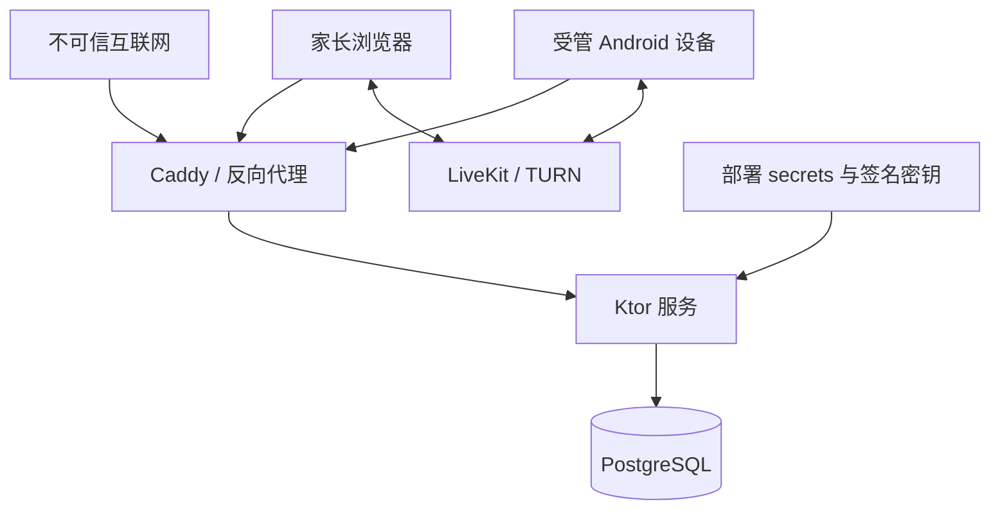

# Guard 威胁模型

更新日期：2026-11-13

本文档是发布前的工程威胁模型，不是渗透测试报告。它描述资产、信任边界、攻击者能力、现有缓解和剩余风险，供安全评审、渗透测试和发布决策使用。

## 1. 范围与安全目标

保护对象包括家长账户、设备身份、签名策略、题库和密钥转移、孩子数据、媒体授权、服务端数据库和部署密钥。

主要安全目标：

1. 未认证或越权家长不能读取、修改或删除其他家庭的数据。
2. 设备只执行由受信任密钥签名、revision 不回退的策略。
3. 孩子端媒体、截图和求助必须有可见授权，不提供静默监控能力。
4. 账户删除后业务数据不可再通过 API 访问，设备 token 和登录凭据失效。
5. 服务端密钥、数据库和备份的泄露面可识别、可轮换、可审计。

## 2. 资产与信任边界

信任边界：

- 互联网到反向代理：不可信网络，依赖 TLS、限流和输入校验。
- 家长浏览器到 API：家长 JWT 和浏览器环境；恶意扩展、被控终端会破坏该边界。
- 孩子设备到 API：设备 token 和 Keystore 证明；已 root 或被系统级恶意软件控制的设备不再可信。
- 服务端到数据库：同一运维信任域；数据库凭据泄露是高风险事件。
- 部署主机到 secrets：仓库外密钥文件或编排 secret；绝不应进入镜像、日志或仓库。
- LiveKit：媒体经第三方或自托管 SFU 传输；房间 token 只在孩子同意后签发。

## 3. 攻击者能力

| 攻击者 | 能力 | 不在范围 |
| --- | --- | --- |
| 未认证互联网攻击者 | 扫描、暴力登录、伪造请求、SSRF 诱导、DoS | 攻破 TLS 或云厂商底层 |
| 恶意或被利用的家长账户 | 读取本家庭数据、尝试越权访问其他家庭 | 绕过服务端所有权检查 |
| 孩子设备使用者 | 操作 UI、尝试退出 kiosk、卸载/清数据、伪造本地状态 | 已 root 设备的内核级绕过 |
| 被盗设备持有者 | 物理访问、锁屏试探、离线读取 | 专业芯片拆解和侧信道 |
| 恶意应用 | 诱导授权、抢焦点、后台启动、伪造通知 | Android 平台内核漏洞 |
| OEM/系统更新 | 改变后台限制、隐藏 API 行为、预装组件 | 平台供应链完全失陷 |
| 服务端运维者/内部人 | 数据库、备份、日志和密钥访问 | 恶意云提供商 |
| 供应链攻击者 | 恶意依赖、构建机或更新通道 | 已签名更新密钥泄露后的无界信任 |
| 网络攻击者 | 中间人、DNS 污染、重放 | 已正确固定密钥的 TLS |

## 4. 主要威胁与控制

| 威胁 | 现有控制 | 剩余风险 |
| --- | --- | --- |
| 家长越权读取其他设备 | JWT audience、设备 `parent_id` 所有权检查、统一 404 | 服务端逻辑漏洞；需渗透测试 |
| 家长 JWT 被盗后长期有效 | 每会话 `sid`、服务端撤销、短 TTL、Sign out 撤销当前会话 | 撤销前已泄露令牌仍可在 TTL 内使用；需设备/浏览器安全配合 |
| 设备 token 被盗或重放 | JWT 过期、Keystore 证明、时间窗、nonce 重放缓存 | 已解锁且被控设备可滥用 token |
| 策略降级或篡改 | ECDSA 签名、key id、revision 防回滚、历史回滚重新签名、白名单校验 | 签名私钥泄露会造成高影响；历史 payload 必须仍能通过当前校验器 |
| 恶意题库或 Delta | 公钥信任集、版本和基线绑定、失败回退完整包 | 上游内容质量和 DNS/egress 仍需运营控制 |
| 暴力登录和注册滥用 | 进程内限流、PBKDF2、统一错误信息 | 单实例内存限流不等于分布式 WAF |
| 账户删除被误触发 | token、精确邮箱、当前密码、`DELETE`、限流、事务删除 | 被完全控制的家长会话仍可执行删除 |
| 删除后备份仍保留数据 | 明确备份边界，要求保留期和传播流程 | **生产备份删除尚未演练** |
| 临时放行撤销后继续使用 | 服务端记录撤销、pending/apply 拒绝已撤销授权、孩子端按 grant id 在下一次同步移除 override、审计 `grant.revoked` | 设备离线时撤销需等待下一次同步；本地授权仍受原到期时间限制 |
| 未授权媒体采集 | 孩子端 Accept/Decline、单次 MediaProjection、审计 | 恶意系统层或已 root 设备可绕过 |
| 家长结束后继续截图 | 服务端原子 `ended`、截图上传校验会话状态、孩子端 5 秒状态轮询并禁用捕获 | 已启动的 MediaProjection 仍需 Android/服务端双重拒绝；上传会失败 |
| 结束通话后重放旧媒体 token | 服务端停止签发、原子 `ended`、LiveKit `DeleteRoom`、15 分钟 token TTL | LiveKit 不能单独吊销已签发 JWT；旧 token 在过期前仍可能重入同名房间，需真实 LiveKit/TURN 渗透测试 |
| 隐蔽监控指控 | 能力可见、无无障碍静默读取、无 root 绕过 | 产品展示和告知不足会造成信任风险 |
| kiosk/Device Owner 逃逸 | Device Owner、锁定任务、隐藏包、可恢复退出阶梯 | OEM 差异和系统更新需真机矩阵 |
| SSRF/DNS rebinding | 仅允许 HTTPS 公网地址、拒绝私网/loopback/凭据/fragment、不跟随重定向 | 需要部署层 egress allowlist 和 DNS 监控 |
| 服务端 secrets 泄露 | `*_FILE` 注入、仓库不含正式密钥、分离保管 | 主机、编排和备份权限仍需加固 |
| 供应链依赖风险 | 锁定版本、保留 NOTICE、构建门禁 | **SBOM 和法务审查未完成** |
| 日志泄露敏感信息 | 不记录正文、密码、token、私钥或截图内容 | 代理日志、异常堆栈和运维查询需单独审查 |

## 5. 关键假设

- 生产环境使用有效 TLS 证书，客户端不关闭证书校验。
- 服务端主机、数据库和 secrets 由受信运维者管理，仓库和镜像中不含正式密钥。
- 孩子设备由组织或家长通过受支持的 Device Owner 流程 provisioning。
- Android 系统未被 root，系统更新和 OEM 后台策略没有被恶意控制。
- LiveKit 和 TURN 的 API secret、房间 token 和网络暴露面得到独立加固。
- 家长设备、浏览器扩展和邮件账户没有已被攻陷；否则会话安全无法由 Guard 单独保证。

## 6. 非目标与明确不承诺

- 不承诺抵御已 root、被物理取证或系统级恶意软件控制的设备。
- 不承诺“绝对不可卸载、绝对不可杀、绝对不可绕过”。
- 不提供隐藏监控、键盘记录、聊天读取、通讯录抓取或持续录屏。
- 不以单机 Docker Compose 代替高可用、灾备和合规托管。
- 不把 JVM/模拟器测试等同于真实硬件、OEM 或生产安全验收。

## 7. 发布前安全门禁

- [ ] 完成一次独立渗透测试并关闭 Critical/High 问题，或有正式风险接受记录。
- [ ] 完成真实 Android 12–15/OEM 设备矩阵和恢复流程演练。
- [ ] 完成签名密钥、JWT、数据库、LiveKit secret 的轮换和泄露响应演练。
- [ ] 完成备份保留期、账户删除传播和恢复演练。
- [ ] 完成 SBOM、许可证和依赖漏洞扫描。
- [ ] 完成隐私政策、儿童告知和数据控制者/处理者安排。
- [ ] 复核限流在反向代理/多实例部署下的真实客户端 IP 语义。

当前状态：工程威胁模型已建立，但独立安全评审和渗透测试**尚未执行**。
